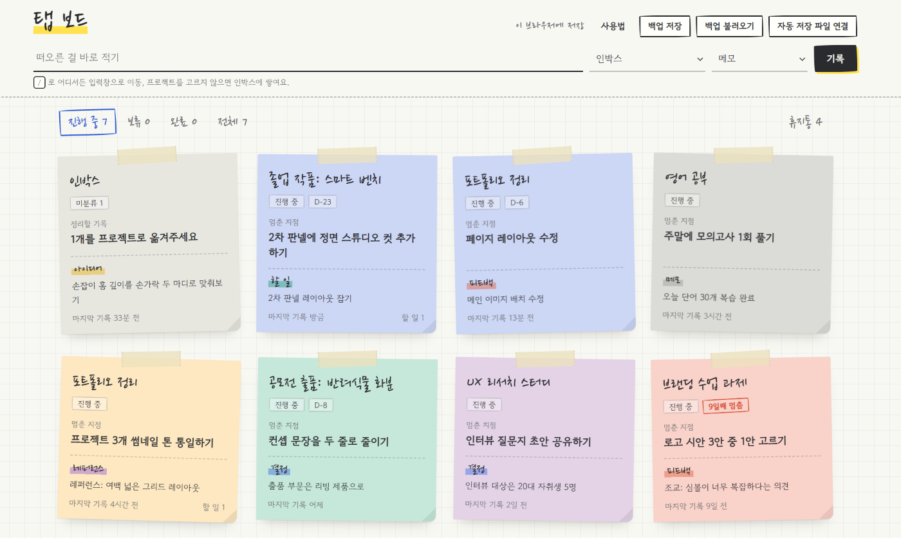
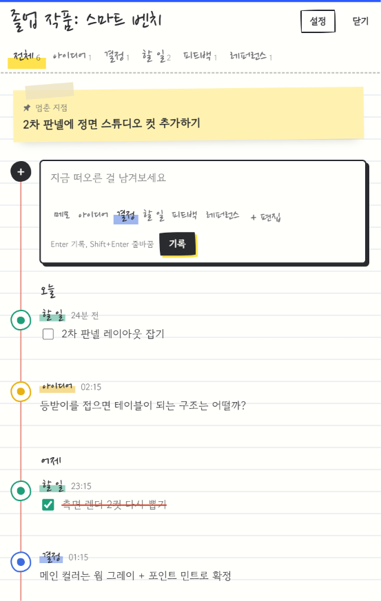

# 🗂️ 탭 보드 (Tab Board)

**여러 프로젝트를 동시에 굴리는 사람을 위한, 멈춘 지점을 잃지 않는 타임라인 메모장**

👉 **바로 사용하기: https://danchu-cloud.github.io/tab-board/**

설치나 회원가입 없이 바로 쓸 수 있어요. 처음 열면 사용법 안내가 뜨고, 기록은 내 브라우저에만 저장됩니다.

<!-- 스크린샷: images 폴더에 main.png, panel.png를 올리면 아래에 표시됩니다 -->

---

## 왜 만들었나요

저는 하나에 오래 집중하기보다, 떠오른 아이디어마다 프로젝트를 여러 탭으로 띄워두고 오가며 작업하는 편입니다. 이 방식에는 반복되는 문제가 있었어요.

- **아이디어 휘발**: 번뜩 떠오른 생각을 적을 곳이 마땅치 않아, 탭을 닫으면 사라집니다.
- **메모 분산**: 기록이 Figma, 메신저, 메모장, AI 채팅에 흩어져 프로젝트별로 모아 보기 어렵습니다.
- **재진입 비용**: 며칠 만에 돌아오면 "어디까지 했더라?"를 다시 떠올리는 데 시간이 듭니다.
- **방치 인지 부족**: 동시에 여러 개를 굴리다 보면 어떤 프로젝트가 멈춰 있는지 보이지 않습니다.

그래서 이 도구의 목표를 **일정 관리가 아니라 맥락 보존**으로 정했습니다. 핵심은 프로젝트마다 남기는 **"멈춘 지점" 한 줄**입니다. 다시 돌아왔을 때 그 한 줄만 보면 바로 이어서 작업할 수 있게요.

---

## 주요 기능

**프로젝트 대시보드**
- 프로젝트를 포스트잇 카드로 한눈에 보여줍니다. 카드마다 멈춘 지점, 최근 기록, 마감 D-day가 표시됩니다.
- 마지막 기록 이후 정해진 기간(기본 3일) 동안 새 기록이 없으면 "n일째 멈춤" 표시가 붙습니다. 기준은 목록 위 **멈춤 기준**에서 바꾸거나 끌 수 있고, 프로젝트마다 따로 정할 수도 있습니다.
- 상태(진행 중, 보류, 완료)로 걸러 볼 수 있고, 지운 프로젝트는 휴지통에서 복원할 수 있습니다.

**빠른 기록**
- 어느 화면에서든 `/` 키로 입력창에 바로 들어가 기록합니다.
- 프로젝트를 고르지 않으면 인박스에 쌓이고, 나중에 프로젝트로 옮길 수 있습니다.

**스레드형 타임라인**
- 프로젝트를 열면 입력창과 기록이 하나의 세로선으로 이어진 피드로 보입니다.
- 기록 유형(메모, 아이디어, 결정, 할 일, 피드백, 레퍼런스)을 구분하고 유형별로 걸러 볼 수 있습니다.
- 나만의 카테고리를 추가하고 이름, 색, 순서를 바꾸거나 지울 수 있습니다. 지운 카테고리의 기록은 메모로 옮겨집니다.
- 기록의 내용과 유형은 언제든 수정할 수 있고, 어떤 기록이든 버튼 하나로 "멈춘 지점"으로 지정할 수 있습니다.

**데이터 보호**
- 백업 파일(JSON) 저장과 불러오기를 지원합니다. 불러오기는 기존 기록을 지우지 않고 합칩니다.
- 마지막 백업 후 7일이 지나면 알림이 뜹니다.
- PC의 크롬·엣지에서는 저장 파일을 연결해 기록할 때마다 자동 저장할 수 있습니다. Google Drive 동기화 폴더에 두면 클라우드 백업까지 자동으로 됩니다.

---

## 디자인 프로세스

**1. 문제 정의**
다중 탭 작업에서 생기는 불편을 아이디어 휘발, 메모 분산, 재진입 비용, 방치 인지 부족의 네 가지로 정리했습니다.

**2. 핵심 사용 시나리오**
- 작업 중 떠오른 생각을 3초 안에 기록한다.
- 프로젝트를 열면 멈춘 지점과 다음 할 일이 가장 먼저 보인다.
- 하루나 한 주 단위로 전체 흐름을 훑어보며 정리한다.

**3. 기능 우선순위 (MoSCoW)**
- **Must**: 프로젝트 관리, 타임라인 메모, 빠른 기록과 인박스, 멈춘 지점, 데이터 저장
- **Should**: 기록 유형 태그, 할 일 체크, 마감 표시
- **Could**: 방치 알림, 디자인 프로세스 단계 트래커, AI 사용 기록 태그, 포트폴리오용 내보내기
- **Won't (이번 단계 제외)**: 협업·공유, 외부 캘린더 연동, 모바일 푸시 알림

**4. MVP 제작과 반복 개선**
메인 화면은 "전체 타임라인"과 "프로젝트 카드 대시보드" 중 재진입이 더 빠른 카드 대시보드로 결정했습니다. 이후 실제로 사용하면서 아래 순서로 개선했습니다.

---

## 디자인 콘셉트: 모눈 스케치북

디자인 작업을 하며 쓰는 아날로그 노트의 감각을 화면으로 옮겼습니다.

- **배경**: 모눈 노트(방안지)
- **프로젝트 카드**: 마스킹테이프로 붙인 포스트잇. 프로젝트 색이 종이 색이 되고, 카드마다 조금씩 다르게 기울어져 있습니다.
- **상세 화면**: 스프링 노트 한 장. 타임라인의 세로선은 노트의 빨간 여백선이고, 멈춘 지점은 노란 포스트잇으로 고정됩니다.
- **강조 표현**: 선택한 필터는 펜으로 동그라미, 기록 유형은 형광펜, 방치 표시는 빨간 펜으로 표현했습니다.
- **글꼴**: 제목과 날짜는 손글씨(나눔펜), 본문과 멈춘 지점은 읽기 편한 고운돋움을 사용해 가독성과 분위기를 나눴습니다.
- 다크 모드에서는 어두운 크라프트 노트 톤으로 바뀝니다.

---

## 사용법

1. **+ 프로젝트 추가**로 진행 중인 프로젝트를 등록합니다.
2. 작업하다 떠오른 것은 상단 입력창에 바로 적습니다.
3. 작업을 멈출 때 프로젝트를 열고 **멈춘 지점**을 한 줄 고쳐둡니다.
4. 다시 돌아오면 카드의 멈춘 지점부터 확인하고 이어서 작업합니다.

| 단축키 | 동작 |
| --- | --- |
| `/` | 빠른 기록 입력창으로 이동 |
| `Enter` | 기록 남기기 |
| `Shift + Enter` | 줄바꿈 |
| `Esc` | 상세 화면 닫기 |

<!-- README.md의 '사용법' 섹션 아래에 붙여 넣으세요 -->

## 💾 PC에서 자동 저장하기 (선택)

탭 보드는 기본적으로 이 브라우저 안에 기록을 저장해요.
PC의 **크롬·엣지**에서는 저장 파일을 한 번 연결해 두면, 기록할 때마다 그 파일에 자동으로 덮어써요.
연결해 두면 백업 알림도 더 이상 뜨지 않아요.

### 지원 환경
- ✅ Windows·Mac의 Chrome, Microsoft Edge
- ❌ Safari, Firefox, 모바일 브라우저, 시크릿(InPrivate) 창

### 연결하는 법 (처음 한 번)
1. 상단 오른쪽 **자동 저장 파일 연결** 버튼을 눌러요.
2. **새 파일 만들기**를 고르고 저장 위치를 정해요.
   - 추천: Google Drive·OneDrive 데스크톱 앱의 동기화 폴더 → 클라우드 백업까지 자동
   - 간단하게: `문서` 폴더 → 브라우저 데이터를 지워도 파일은 남아요
3. 브라우저가 파일 수정 권한을 물으면 **허용**을 눌러요.
   선택지에 “항상 허용”이 보이면 그걸 고르면 재연결 횟수가 줄어요.
4. 상단에 **파일에 자동 저장 (방금)**이 보이면 완료예요.

### 이후 사용
- 평소처럼 쓰면 돼요. 따로 저장할 필요가 없어요.
- 브라우저를 다시 열면 **파일 저장 멈춤 · 다시 연결**이 뜰 수 있어요.
  보안상 브라우저가 권한을 초기화한 것이니 **다시 연결 → 허용**만 누르면 이어서 저장돼요.
- **파일에 저장하지 못했어요**가 뜨면 파일이 옮겨졌거나 지워진 거예요.
  기록은 브라우저에 그대로 있으니 **다시 연결 → 다른 새 파일로 바꾸기**로 저장 위치를 다시 정해 주세요.

### 다른 PC에서 이어 쓰기
1. 다른 PC에서 **자동 저장 파일 연결 → 기존 파일 연결하기**를 눌러요.
2. 동기화 폴더의 같은 파일을 선택해요.
3. 파일 쪽 기록이 더 최신이면 바꿀지 먼저 물어봐요. **확인**을 누르면 파일 내용으로 바뀌어요.

> ⚠️ 두 PC에서 동시에 열어두고 기록하면 나중에 저장한 쪽이 덮어써요. 한 번에 한 곳에서만 써주세요.
> ⚠️ 저장 파일(.json)을 직접 열어 고치지 마세요. 기록이 깨질 수 있어요.

### 버튼이 안 보여요
- 크롬·엣지가 맞는지, 시크릿 창이 아닌지 확인해 주세요.
- 페이지를 **Ctrl+Shift+R**(Mac은 Cmd+Shift+R)로 강력 새로고침해 보세요.

---

## 데이터와 개인정보

- 모든 기록은 **사용자의 브라우저 안에만** 저장되며, 어떤 서버로도 전송되지 않습니다.
- 브라우저 데이터를 지우면 기록도 함께 사라지므로 **백업 저장** 또는 **자동 저장 파일 연결**을 권장합니다.
- 기기 간 동기화는 지원하지 않습니다. 다른 기기로 옮길 때는 백업 파일을 불러와 주세요.

---

## 기술 구성

- HTML, CSS, JavaScript 단일 파일 (별도 프레임워크나 빌드 과정 없음)
- 저장: localStorage, IndexedDB, File System Access API (파일 자동 저장)
- 글꼴: [Gowun Dodum](https://fonts.google.com/specimen/Gowun+Dodum), [Nanum Pen Script](https://fonts.google.com/specimen/Nanum+Pen+Script) (Google Fonts)
- 배포: GitHub Pages

---

## 버전 기록

- **v1.0**: MVP. 프로젝트 카드 대시보드, 타임라인 메모, 빠른 기록과 인박스, 멈춘 지점
- **v1.1**: 휴지통 (삭제 후 되돌리기, 복원, 영구 삭제)
- **v1.2**: 상세 화면을 입력창과 타임라인이 이어지는 스레드형 피드로 통합
- **v1.3**: 아날로그 노트 디자인으로 전면 개편
- **v1.4**: 백업 저장과 불러오기
- **v1.5**: 저장 안정성 강화 (영구 보관 요청, 백업 알림, 파일 자동 저장)
- **v1.6**: 처음 방문자를 위한 사용법 안내(튜토리얼)와 예시 프로젝트, 기록 내용·유형 수정
- **v1.7**: 나만의 카테고리 추가와 관리 (이름, 색, 순서 변경, 삭제)
- **v1.7.1**: 다크 모드에서 선택 목록 글씨가 잘 보이도록 개선
- **v1.8 (2026.10.20)** 자동 저장 연결 가이드 추가 — 연결 창 안 단계별 안내, 상태별 도움말, 저장 실패 상태 구분
- **v1.9 (2026.10.20)** 멈춤 기준 직접 설정 — 기본 3일, 1~60일 조절·끄기, 프로젝트별 기준, 새 기록(메모)만 활동으로 계산
---

## 만든 사람

- **기획·디자인·피드백**: 단추의눈물
- **구현**: Claude(Anthropic)와 대화하며 협업해 제작했습니다. 문제 정의, 기능 우선순위, 디자인 방향과 수정 사항은 직접 결정했고, 코드 작성은 AI의 도움을 받았습니다.

버그나 제안은 [Issues](https://github.com/danchu-cloud/tab-board/issues)에 남겨주세요.
